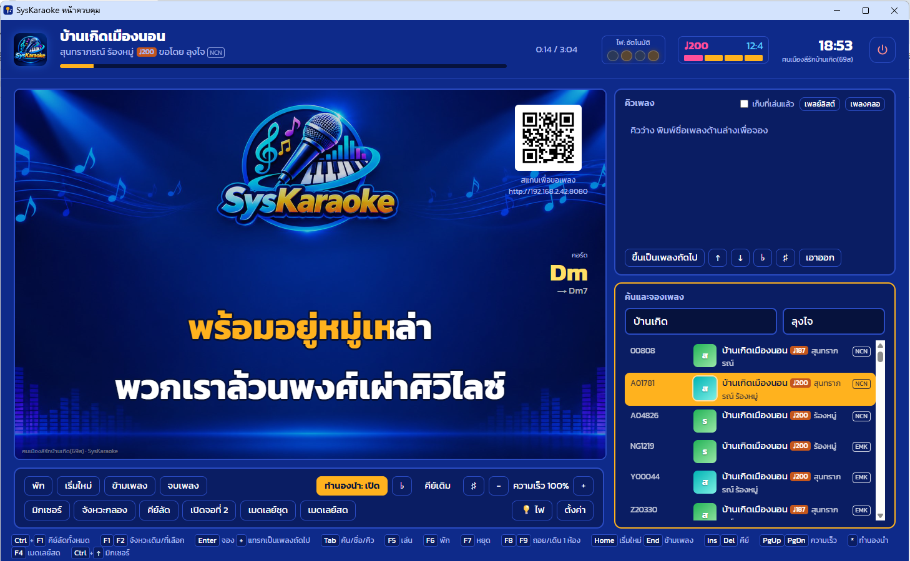
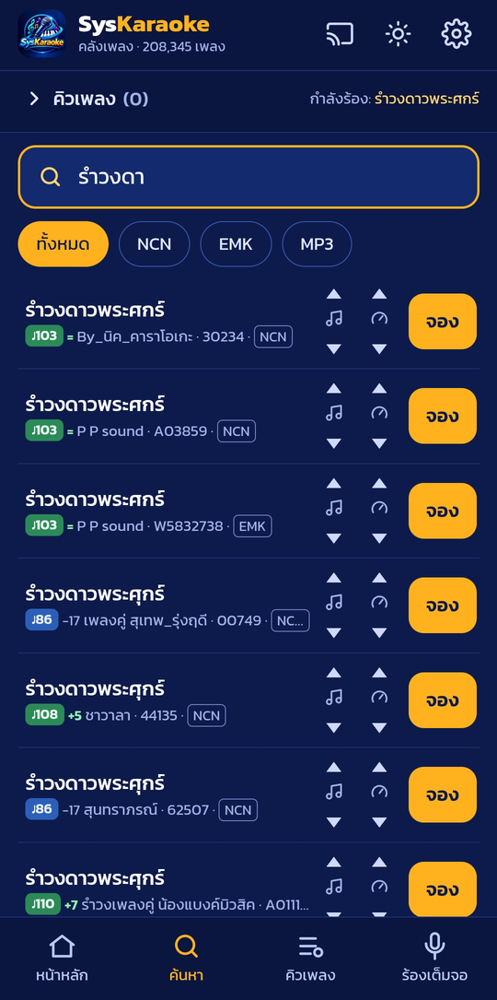
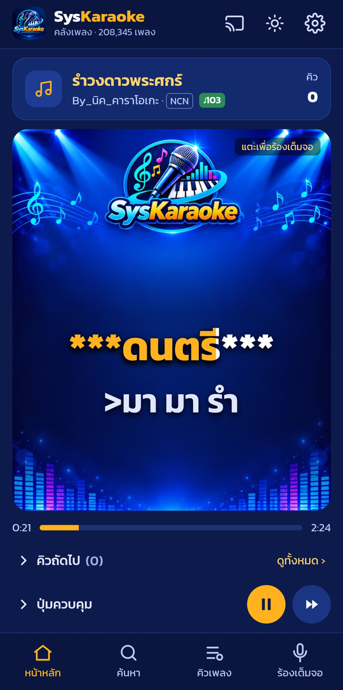
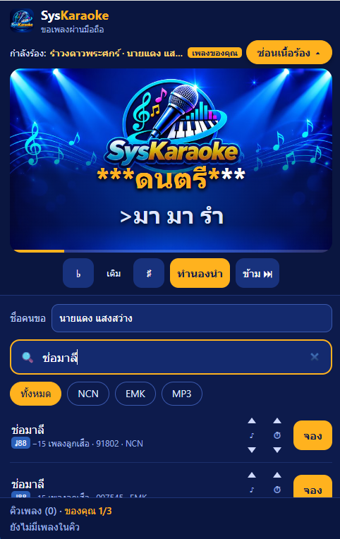
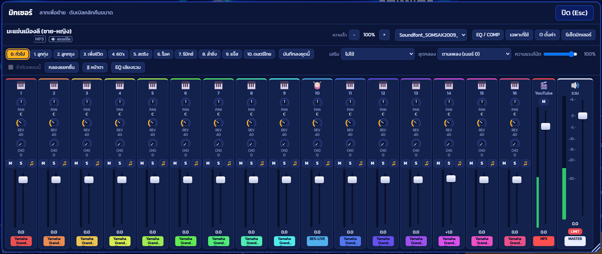
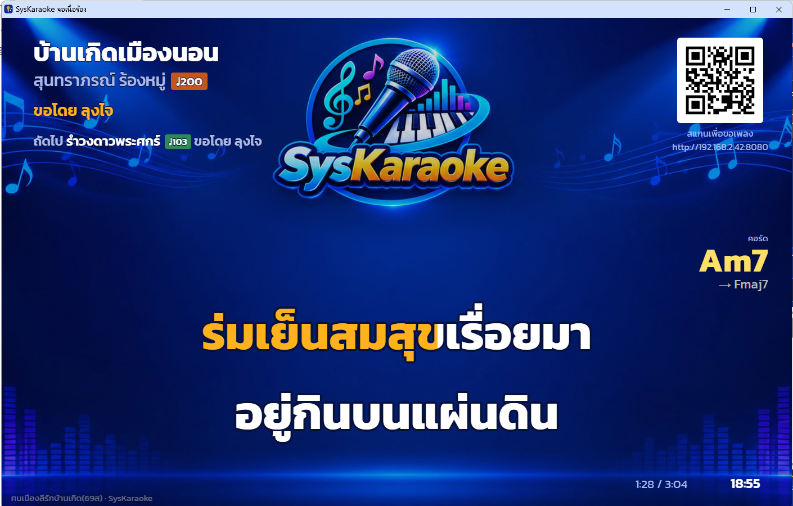

# 🎤 SysKaraoke

โปรแกรมคาราโอเกะ MIDI สำหรับเพลง NCN / EMK มีทั้ง **รุ่น PC (Windows)** และ **แอปมือถือ / กล่องทีวี Android**
เนื้อร้องขึ้นจอทีวี มิกเซอร์ปรับเสียงแยกเครื่องดนตรี เพื่อนขอเพลงจากมือถือตัวเองได้ด้วยการสแกน QR

**แจกฟรี** ใช้ได้ทั้งที่บ้าน ร้านอาหาร งานเลี้ยง และชุมชน

  

  
  
  

## ⬇️ ดาวน์โหลด

ไปที่หน้า **[Releases](../../releases/latest)** แล้วเลือกไฟล์

| ใช้กับ | ไฟล์ |
| --- | --- |
| Windows 10 / 11 (64 บิต) | `SysKaraoke_Free_Setup_xxxx.xx.xx.exe` |
| มือถือ / กล่องทีวี / Android TV (Android 7 ขึ้นไป) | `SysKaraokeMobile-x.x.x.apk` |
| คู่มือเริ่มใช้งานแอปมือถือ | ไฟล์ PDF |

> ดาวน์โหลดจากหน้านี้เท่านั้น โปรแกรมนี้แจกฟรี **ถ้ามีคนขาย แปลว่าไม่ใช่ของแท้**
>
> โปรแกรมไม่มีเพลงและ SoundFont มาให้ ใช้ไฟล์ที่ตัวเองมีสิทธิ์ใช้งาน

## ความสามารถ

### 💻 รุ่น PC

- เล่นเพลง NCN / EMK อ่านรายชื่อเพลงจาก `SONG.DBF` ได้ทันที ไม่ต้องสแกนทีละไฟล์
- ค้นหาจากรหัส ชื่อเพลง ศิลปิน หรือเนื้อร้อง พร้อมป้ายความเร็วเพลง (BPM)
- จอเนื้อร้องบนทีวี (จอที่ 2) พร้อมคิวเพลง
- มิกเซอร์แยกเครื่องดนตรี EQ / Compressor / Reverb เลือกชุดกลองตามแนวเพลงได้
- ใช้ SoundFont (.sf2) ของตัวเองได้
- เพื่อนขอเพลงจากมือถือผ่าน QR ไม่ต้องลงแอป
- ไฟปาร์ตี้ DMX เต้นตามจังหวะเพลง
- คีย์ลัดครบ ใช้คีย์บอร์ดอย่างเดียวได้
- ตรวจรุ่นใหม่ให้เอง (แท็บ **เกี่ยวกับ**)

### 📱 แอปมือถือ / กล่องทีวี

- ใช้โฟลเดอร์เพลงชุดเดียวกับ PC (`Songs` + `Data/SONG.DBF`) คัดลอกลงมือถือหรือการ์ด SD
- ปรับคีย์และความเร็วได้ตั้งแต่ตอนเลือกเพลง ป้าย BPM บอกว่าเร็วหรือช้ากว่าเพลงที่เล่นอยู่
- ซินธ์ในตัว รองรับ SoundFont ไฟล์ใหญ่ ชุดกลอง Reverb Chorus และมิกเซอร์ย่อ
- เล่น MP3 ปรับคีย์และความเร็วได้
- แคสขึ้นทีวี ทีวีแสดงเฉพาะเนื้อร้องและคิวเพลง เลือกให้เสียงออกทีวีหรือมือถือได้
- เพื่อนสแกน QR ขอเพลงได้คนละ 3 เพลง ดูเนื้อร้องเพลงตัวเอง ปิดทำนองนำ ข้ามเพลงตัวเองได้
- แอดมินคุมได้ทุกอย่าง จองไม่จำกัด เข้าด้วย QR หรือ PIN
- โหมดกล่องทีวี ใช้รีโมท เมาส์ หรือคีย์บอร์ดก็ได้
- ธีมมืด / สว่าง แนวตั้ง / แนวนอน
- ตรวจรุ่นใหม่ให้เอง (หน้า **ตั้งค่า**)

  
  

## ติดตั้งรุ่น PC

1. ดับเบิลคลิกไฟล์ Setup ที่โหลดมา
2. กด Next ไปเรื่อยๆ ใช้โฟลเดอร์ที่โปรแกรมแนะนำ (**อย่าติดตั้งลง Program Files**)
   - ติ๊ก **Allow phones on the same Wi-Fi to connect** ถ้าจะให้เพื่อนขอเพลงจากมือถือ
3. วางไฟล์ SoundFont (.sf2) ในโฟลเดอร์ `SoundFonts` แล้วเลือกคลังเพลงในโปรแกรม

> **Windows แจ้งเตือน "Windows protected your PC"?**
> กด **More info → Run anyway** (โปรแกรมไม่ได้ซื้อใบรับรองดิจิทัล)

ออกรุ่นใหม่ โหลดไฟล์ Setup มาติดตั้งทับได้เลย เพลง SoundFont และการตั้งค่าเดิมไม่หาย

## ติดตั้งแอปมือถือ

1. โหลดไฟล์ `.apk` แล้วแตะเพื่อติดตั้ง อนุญาต "ติดตั้งแอปที่ไม่รู้จัก" ถ้ามีถาม
2. Play Protect เตือน ให้กด **ติดตั้งต่อ**
3. เปิดแอป กด **เลือกโฟลเดอร์คาราโอเกะ** เลือกโฟลเดอร์ที่มี `Songs` และ `Data` อยู่ข้างใน

**กล่องแอนดรอยด์ / Android TV:** คัดลอก APK ลงแฟลชไดรฟ์แล้วเปิดด้วยแอปจัดการไฟล์ หรือใช้แอป Downloader
ทีวี Samsung (Tizen) และ LG (webOS) ติดตั้งไม่ได้ ใช้วิธีแคสหน้าจอจากมือถือแทน

รายละเอียดทั้งหมดอยู่ในคู่มือ PDF หน้า Releases

## ความเป็นส่วนตัว

- การตรวจรุ่นใหม่แค่อ่านหน้า Releases ของ GitHub ไม่ส่งข้อมูลใดๆ ออกไป
- แอปมือถือจะถามหนึ่งครั้งว่ายินยอมแจ้งผู้พัฒนาว่ามีคนใช้อยู่ไหม ส่งแค่รหัสสุ่ม รุ่น และเวอร์ชัน ไม่ยินยอมก็ใช้งานได้ปกติ
- รุ่น PC ส่งความคิดเห็นถึงผู้พัฒนาได้ในแท็บ **เกี่ยวกับ** ส่งเฉพาะเมื่อผู้ใช้กดส่งเอง

พบปัญหาหรืออยากได้ฟีเจอร์ แจ้งได้ที่ [Issues](../../issues)

## ข้อตกลงการใช้งาน

แจกฟรี ใช้ได้ทั้งส่วนตัวและในร้าน **ห้ามจำหน่ายโปรแกรม** รายละเอียดใน [LICENSE.txt](LICENSE.txt)

---

พัฒนาโดย **ฅนเมืองลีรักบ้านเกิด**
